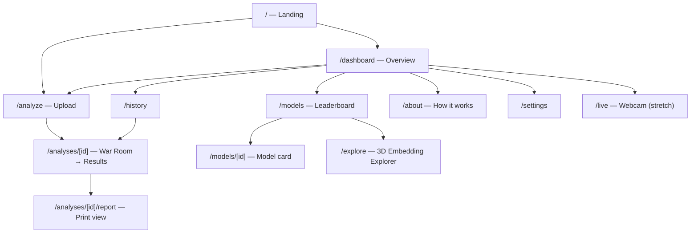
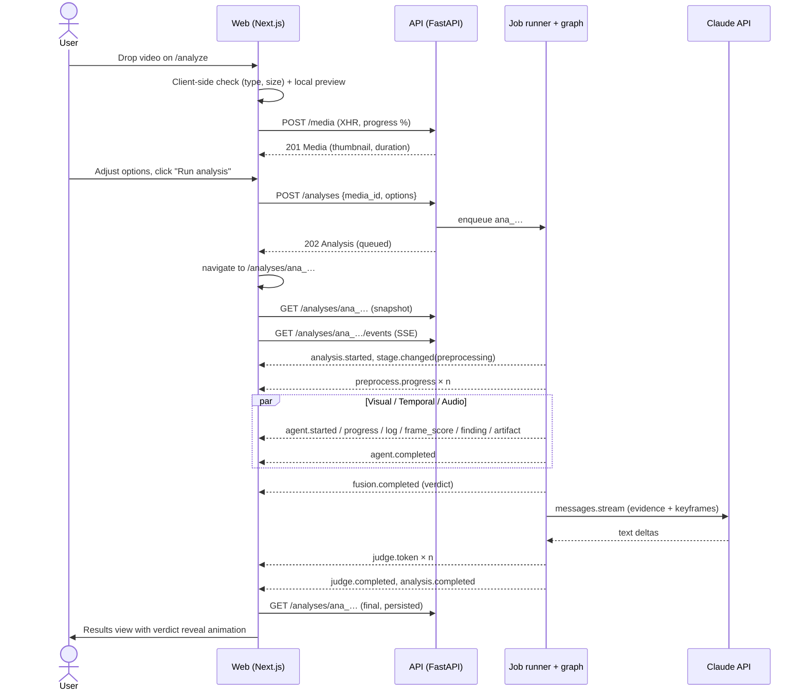
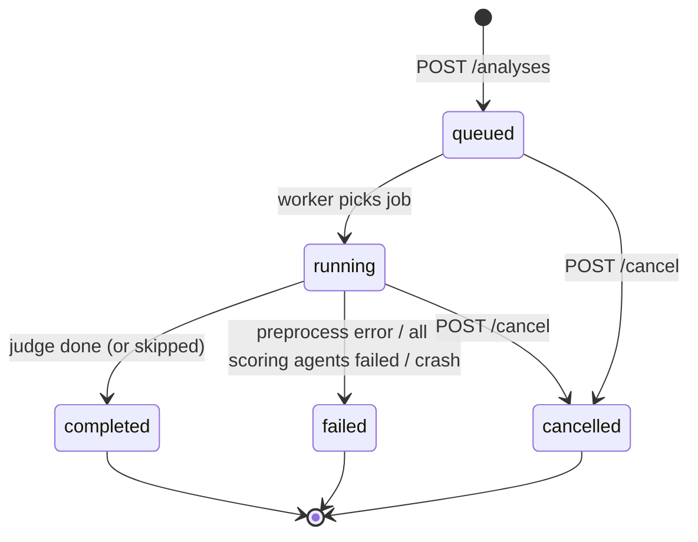

# App Flow

How users move through Aletheia, what each screen does, and how the analysis lifecycle drives the UI. Visual details are in [Design.md](Design.md); API shapes are in [API.md](API.md).

## 1. Sitemap



| Route | Purpose | Phase | Priority |
|---|---|---|---|
| `/` | Landing: hero, what it does, CTA "Analyze media", live system status | 3 | P0 |
| `/dashboard` | KPIs, verdict distribution, activity chart, recent analyses, agent health | 5 | P0 |
| `/analyze` | Drag-and-drop upload, media preview, options, start | 3 | P0 |
| `/analyses/[id]` | Live war room while running; results when done | 4 | P0 |
| `/analyses/[id]/report` | Print-friendly report (also the source for PDF styling) | 5 | P1 |
| `/history` | Searchable, filterable table of analyses | 5 | P0 |
| `/models` | Leaderboard: ours vs baselines, per-dataset metrics, ROC | 5 / 7 | P1 |
| `/models/[id]` | Model card: architecture, training setup, metrics, confusion matrix | 7 | P1 |
| `/explore` | 3D embedding explorer (real vs fake clusters) | 5 / 7 | P2 |
| `/about` | Pipeline diagram, agent explanations, the math, datasets, limits | 5 | P1 |
| `/settings` | API status, limits, Judge on/off, theme, retention, purge data | 5 | P1 |
| `/live` | Webcam real-time visual score | 8 | P2 |

Global shell: collapsible left sidebar (Dashboard, Analyze, History, Models, Explore, About, Settings), top bar with a command palette trigger (Ctrl/⌘+K), API status dot, theme toggle. The landing page uses a full-bleed layout without the sidebar.

## 2. Primary journey: analyze a video



### Step by step

1. **`/analyze` — empty state.** A large drop zone ("Drop an image, video or audio clip"), accepted formats and limits underneath, and three sample clips from the demo set ("Try a sample").
2. **File chosen.** The client validates the extension and size immediately (same limits as the API). A bad file → inline error, nothing uploaded.
3. **Uploading.** Progress bar with bytes/percent and a cancel button. The local preview (video player / image / waveform) appears right away using an object URL.
4. **Uploaded.** The media card shows server-side facts: duration, resolution, fps, audio yes/no, SHA-256 (short). If the file was already uploaded before, a notice links to its previous analyses.
5. **Options panel** (collapsed by default under "Advanced"): agent toggles (disabled with a tooltip when not applicable, e.g. Audio for an image), frames to sample (8–64 slider), Judge on/off, heatmaps on/off.
6. **Run analysis** → `POST /analyses` → route to `/analyses/[id]`.

## 3. The War Room (`/analyses/[id]` while running)

Layout (desktop):

```
┌──────────────────────────────────────────────────────────────────────────┐
│ ← History   interview_clip.mp4 · 31 s · 1080p        [MOCK]  [Cancel]    │
├──────────────────────────────┬───────────────────────────────────────────┤
│                              │  Pipeline: ●Preprocess ●Agents ○Fusion ○Judge│
│   Media player               ├───────────────────┬───────────────────────┤
│   (heatmap overlay toggle)   │ VISUAL   ◐ 62%    │ TEMPORAL  ◐ 40%       │
│                              │ "Scored 20/32…"   │ "Optical flow…"       │
│                              │ score ▁▂▅▇        │ score ▁▁▂▃            │
│                              ├───────────────────┼───────────────────────┤
│                              │ AUDIO    ✓ 0.18   │ JUDGE   ○ waiting     │
│                              │ "Voice looks nat…"│                       │
├──────────────────────────────┴───────────────────┴───────────────────────┤
│ Live evidence timeline  ▁▂▂▃▅▇▇▆▃▂▁   (frame scores stream in)           │
├──────────────────────────────────────────────────────────────────────────┤
│ Agent log (monospace, streaming)                                          │
│ 14:03:24 visual   Face found in 32/32 frames                              │
│ 14:03:25 temporal High-frequency energy ratio 0.31 (baseline 0.22)        │
└──────────────────────────────────────────────────────────────────────────┘
```

Behaviour:

- **Snapshot then stream.** On mount, fetch `GET /analyses/{id}` to render the current state, then open SSE. Replay guarantees nothing is missed.
- **Agent cards** move through `queued → running → completed | failed | skipped`, with a progress ring, the latest `agent.log` line, a live sparkline of `agent.frame_score`, and a backend badge (`MOCK` / `MODEL` / `LLM` / `RULES`).
- **Findings** appear as small chips under each card as `agent.finding` arrives; clicking one seeks the player.
- **Fusion** → a verdict gauge animates in (see [Design.md](Design.md#verdict-gauge)).
- **Judge** → the card expands into a report panel and `judge.token` text types itself in, rendering Markdown progressively.
- **Terminal event** → a short "verdict reveal" (gauge settles, label stamps in, confetti-free), then the page switches into the Results layout without a reload.
- **Cancel** → confirmation dialog → `POST /cancel` → cards show "cancelled".
- **Connection lost** → a banner "Reconnecting…"; `EventSource` retries automatically with `Last-Event-ID`.

## 4. Results (`/analyses/[id]` when completed)

Header: filename, verdict badge, fake probability, confidence, agreement indicator (consensus / mixed / conflict), MOCK badge if `is_mock`, actions: **Download PDF**, **Re-run**, **Delete**, **Copy link**.

Tabs:

| Tab | Contents |
|---|---|
| **Summary** | Verdict gauge; per-agent contribution bars; Judge report (Markdown) with key-evidence cards that link to the relevant tab and timestamp; caveats |
| **Visual** | Frame grid of the most suspicious frames with heatmap overlay and opacity slider; per-frame score chart; face crops; findings list |
| **Temporal** | Evidence timeline (all agents, colour-coded) synced to the video player; flicker segments; FFT spectrum real vs. this-video comparison; optical-flow map |
| **Audio** | Waveform with suspicious regions highlighted (wavesurfer regions); spectrogram; findings |
| **Metadata** | Container/codec info, EXIF, C2PA presence, metadata findings |
| **Raw** | Pretty-printed JSON of the full analysis (for the viva: "here is exactly what the API returned") |

Tabs that don't apply (e.g. Audio for an image) are hidden, not disabled.

## 5. Other journeys

### 5.1 Dashboard (`/dashboard`)

1. KPI tiles: total analyses, fake rate, average processing time, agents healthy (4/4).
2. Verdict distribution donut (real / fake / uncertain).
3. Activity area chart (analyses per day, fake overlay), range switch 7d / 30d / all.
4. Recent analyses list (thumbnail, verdict chip, time ago) → click opens results.
5. Agent health strip: each agent's backend, average duration, success rate.
6. Empty state (first run): an illustration, "No analyses yet", buttons for "Analyze media" and "Try a sample".

### 5.2 History (`/history`)

Table with thumbnail, filename, kind, verdict, P(fake), confidence, duration, created time. Filters: verdict, kind, status, date range; search by filename; sort by date or P(fake). Multi-select → bulk delete (confirmation dialog). Infinite scroll via cursor pagination. URL query string mirrors the filters so a filtered view can be shared.

### 5.3 Models (`/models`)

Leaderboard table grouped by agent. Columns: model, source badge (`OURS` / `PAPER` / `PENDING`), train set, trainable params, in-domain AUC/Acc, cross-dataset AUC. Selecting up to 3 rows overlays their ROC curves. Placeholder rows are greyed out with "Training pending (Phase 7)". Paper rows show a citation tooltip.

### 5.4 Explorer (`/explore`)

Pick a model and dataset → 3D point cloud (orbit, zoom), coloured by real/fake, shape or shade by manipulation type. Hover → tooltip (and a thumbnail where the license allows). Toggle 2D/3D. Before Phase 7 it shows the synthetic demo set with a clear "synthetic demo data" banner.

### 5.5 About (`/about`)

An animated pipeline diagram (click a node to expand), one section per agent (what it looks at, why it works, what fools it), the fusion equation rendered with KaTeX, datasets and metrics definitions, limitations and ethics. This page is our viva companion.

### 5.6 Settings (`/settings`)

API connection and readiness checks (live), upload limits, Judge model and on/off status (read from the server — keys are never shown), theme, reduced-motion override, retention period, "Delete all data" (typed confirmation).

## 6. Analysis lifecycle (state machine)



Stages inside `running`: `preprocessing → agents → fusion → judge → finalizing → done`.

Per-agent states: `pending → running → completed | failed | skipped | cancelled`.

## 7. Error and edge flows

| Situation | What the user sees |
|---|---|
| Unsupported type / too large (client check) | Inline error on the drop zone; nothing uploaded |
| Server rejects upload (415/413/422) | Toast + inline message using the API's `detail` text |
| Network drop during upload | "Upload failed — Retry" button; the partial upload is discarded |
| Queue full (503) | Toast "The analyzer is busy — try again in a minute" |
| No face found in any frame | Visual agent → `skipped` with reason "No face detected"; a `no_face_detected` finding; verdict relies on the other agents; the Judge mentions it |
| Video without audio | Audio agent card shows "No audio track" (skipped) |
| One agent fails | Card turns red with the error message; analysis still completes; the Judge notes reduced evidence; the verdict confidence is lower |
| All scoring agents fail | `analysis.failed`; an error panel with a "Re-run" button and the request ID |
| Claude API down / no key | Judge shows `RULES` badge; report is template-based; no error shown to the user beyond the badge tooltip |
| SSE disconnect | "Reconnecting…" banner; resumes from the last event |
| Analysis not found / deleted | 404 page with a link to History |
| API unreachable | Global banner "Can't reach the analysis server" + readiness details on hover |
