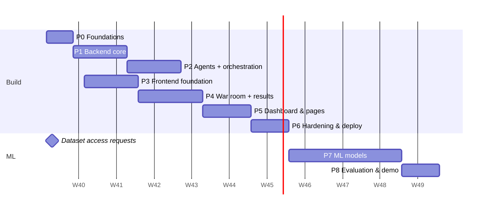

# Implementation Plan

**Strategy:** build the whole product — backend, 4 agents, dashboard — on top of **mock detectors with real signal processing**, make it solid, then replace the mocks with trained models. Because every agent talks to a `Detector` interface from day one, the ML phase changes configuration, not the app.

**Owners (proposal — adjust in [OpenQuestions.md](OpenQuestions.md#q-04)):**
- **H** = Harshdeep → backend, pipeline, agents
- **G** = Girikshit → frontend, design system, visualizations
- **H+G** = pair / shared

**Timeline:** 12 weeks, starting the week of 2026-10-05. The deadline isn't confirmed yet ([Q-02](OpenQuestions.md#q-02)); if it's earlier, cut P2 items first, then compress Phase 8.

Phases 1–2 (backend, **H**) and 3–4 (frontend, **G**) run **in parallel**. They meet at the API contract ([API.md](API.md)), which is frozen at the end of Phase 0 and changed only through PRs that update the doc.

---

## Phase 0 — Foundations (Week 1)

**Goal:** both of us can clone, run, and ship a PR on day 5.

| ID | Task | Owner |
|---|---|---|
| P0-01 | Create monorepo structure (`apps/api`, `apps/web`, `ml/`, `docs/`, `data/` gitignored) per [TechSpecifications.md §3](TechSpecifications.md#3-repository-layout) | H |
| P0-02 | `apps/api`: uv project, FastAPI hello world, Ruff, Pyright, pytest, `/health` | H |
| P0-03 | `apps/web`: Next.js + TS strict + Tailwind v4 + shadcn/ui init, ESLint, Prettier, Vitest | G |
| P0-04 | GitHub Actions CI: lint + typecheck + test for both apps on every PR | H |
| P0-05 | Branch protection on `main`, PR template, labels ([Contributing.md](Contributing.md)) | H |
| P0-06 | `.env.example` files, `Setup.md` verified on both laptops (Windows) | H+G |
| P0-07 | Freeze API contract v1: review [API.md](API.md) together, resolve disagreements | H+G |
| P0-08 | Design tokens in `globals.css` + font setup + theme toggle | G |
| P0-09 | **Submit dataset access requests** (FaceForensics++, Celeb-DF v2); note dates in [Tracker.md](Tracker.md) | H+G |
| P0-10 | Collect a demo set: 6–10 clips (real + known fakes from public sources with a permissive license), record source + license in `data/demo/manifest.json` | G |

**Exit criteria:** CI green on `main`; `GET /health` returns ok; web app renders the tokenized shell in both themes; API contract signed off; dataset forms submitted.

---

## Phase 1 — Backend core (Weeks 2–3) · **H**

**Goal:** upload a file, create an analysis, watch a fake pipeline stream events end-to-end.

| ID | Task |
|---|---|
| P1-01 | Settings (`config.py`), structured logging, request-ID middleware, RFC 9457 error handler, CORS |
| P1-02 | DB layer: async engine, ORM models for all tables in [Schema.md](Schema.md), Alembic initial migration |
| P1-03 | ID helpers (prefixed ULIDs), storage protocol + local storage |
| P1-04 | `POST /media`: streaming upload to a temp file, size cap while streaming, SHA-256, magic-byte sniffing, ffprobe, thumbnail, dedup |
| P1-05 | `GET/DELETE /media/*`, file endpoint with HTTP Range support |
| P1-06 | Job runner (asyncio queue, workers, cancellation, startup recovery) |
| P1-07 | Event bus: persist to `analysis_events` + in-memory fan-out; SSE endpoint with `Last-Event-ID` replay and heartbeat |
| P1-08 | `POST/GET/DELETE /analyses`, list with filters + cursor pagination, `/cancel`, `/rerun` |
| P1-09 | A stub pipeline that sleeps and emits the full event sequence (lets **G** build the war room early) |
| P1-10 | Rate limiting, `/health/ready`, retention job |
| P1-11 | Tests: unit (validators, IDs, pagination), integration (upload → analyze → stream → complete) |

**Exit criteria:** `curl` walkthrough in [API.md §7](API.md#7-example-session) works; SSE replay works after a disconnect; ≥ 80% coverage on `services/` and `events/`.

---

## Phase 2 — Agents & orchestration (Weeks 4–5) · **H**

**Goal:** the 4 real agents run on the LangGraph pipeline, with genuine signal processing, mock scores, and a Claude-written report.

| ID | Task |
|---|---|
| P2-01 | Preprocessing: frame sampling, YuNet face detection + crops, 16 kHz audio extraction, metadata/C2PA check |
| P2-02 | `Detector` protocol + registry + `mock-visual`, `mock-temporal`, `mock-audio` (deterministic, scenario support in dev) |
| P2-03 | Agent base class with `emit` helpers and timing; `AgentResult` persistence (`agent_runs`, `findings`, `frame_scores`, `artifacts`) |
| P2-04 | **Visual agent**: crops, blur/quality metrics, mock scores, mock saliency heatmaps, top-k suspicious frames |
| P2-05 | **Temporal & Frequency agent**: FFT azimuthal spectrum + HF energy ratio, SSIM flicker, Farneback optical flow, bbox jitter → findings + spectrum/flow artifacts |
| P2-06 | **Audio agent**: log-mel spectrogram, RMS, silence ratio, pitch; mock score; suspicious segments; spectrogram artifact |
| P2-07 | LangGraph graph: preprocess → metadata → parallel agents → fusion → judge; routing by media kind; partial-failure handling |
| P2-08 | Fusion module (weighted log-odds, disagreement, labels) + unit tests with hand-computed cases |
| P2-09 | **Judge agent**: Claude streaming client, system prompt, evidence packing, keyframe images, JSON tail parsing, refusal/fallback handling, token usage logging |
| P2-10 | Rule-based Judge fallback |
| P2-11 | `GET /agents`, `GET /analyses/{id}/frames`, `GET /artifacts/{id}` |
| P2-12 | PDF report service (ReportLab) + `GET /report.pdf` |
| P2-13 | Tests: agent contract tests (every agent returns a valid `AgentResult` for each media kind and scenario), graph routing tests, Judge tests with a stubbed client |

**Exit criteria:** image, video (with/without audio), and audio each complete in the time budgets of [TechSpecifications.md §6](TechSpecifications.md#6-performance-targets-backend-cpu-mock-detectors); the Judge report cites findings; killing the API key flips the Judge to `rules` without errors.

---

## Phase 3 — Frontend foundation (Weeks 2–3) · **G**

**Goal:** app shell, design system, and a working upload flow against the real API.

| ID | Task |
|---|---|
| P3-01 | App shell: sidebar, top bar, theme toggle, API status dot, route skeletons for every page in [Appflow.md §1](Appflow.md#1-sitemap) |
| P3-02 | Background system (grid, noise, aurora), typography, base components restyled to tokens |
| P3-03 | API client: `pnpm gen:api` from `/openapi.json`, typed fetch wrapper, problem+json error parsing, TanStack Query setup |
| P3-04 | `/analyze`: dropzone, client validation, XHR upload with progress, media preview, options panel, start analysis |
| P3-05 | Forensic component library v1 in isolation (a `/dev/components` page): VerdictGauge, AgentCard (all 5 states), StatTile, MockBadge, BackendBadge, FindingCard |
| P3-06 | Landing page v1 (static hero poster, agent cards, CTA) |
| P3-07 | Tests: component tests for gauge maths, upload validation, error parsing |

**Exit criteria:** a file uploads to the real API from `/analyze` and lands on `/analyses/[id]`; components pass axe checks in both themes.

---

## Phase 4 — War room & results (Weeks 4–5) · **G** (with **H** on SSE)

**Goal:** the signature experience.

| ID | Task |
|---|---|
| P4-01 | `useAnalysisStream` hook + `warRoomStore` (zod-parsed events, snapshot + stream merge, reconnect banner) |
| P4-02 | War-room layout: pipeline stepper, 2×2 agent grid, live log, live timeline |
| P4-03 | Judge panel with streaming Markdown rendering |
| P4-04 | Verdict reveal animation + transition to results layout |
| P4-05 | Results: Summary tab (gauge, contributions, report, evidence cards, caveats) |
| P4-06 | Visual tab: HeatmapViewer, suspicious frame grid, per-frame chart |
| P4-07 | Temporal tab: EvidenceTimeline synced to the video player, SpectrumViewer, flow map |
| P4-08 | Audio tab: WaveformPlayer with regions + spectrogram |
| P4-09 | Metadata tab + Raw JSON tab |
| P4-10 | Cancel / re-run / delete / copy-link actions; all error states from [Appflow.md §7](Appflow.md#7-error-and-edge-flows) |
| P4-11 | Responsive pass (1024 / 640 / 375 px) and reduced-motion pass |

**Exit criteria:** every mock scenario (`real`, `fake`, `uncertain`, `disagree`, `agent_fail`) renders correctly live and after refresh; a mid-analysis refresh restores the war room exactly.

---

## Phase 5 — Dashboard & secondary pages (Weeks 6–7) · **G** + **H**

| ID | Task | Owner |
|---|---|---|
| P5-01 | `GET /metrics/overview` + `/dashboard` (stat tiles, activity chart, donut, recent, agent health) | H (API), G (UI) |
| P5-02 | `/history`: table, filters synced to URL, search, infinite scroll, bulk delete | G |
| P5-03 | `model_registry` seed script (placeholders + paper baselines with citations) + `GET /models*` | H |
| P5-04 | `/models` leaderboard + ROC overlay (placeholder state) | G |
| P5-05 | `/explore` 3D explorer with the synthetic demo set (clearly labelled) | G |
| P5-06 | `/about`: pipeline diagram, agent explainers, KaTeX fusion math, datasets, limitations | H+G |
| P5-07 | `/settings` (+ `/settings/public`, `/admin/purge`) | H+G |
| P5-08 | Print report page + PDF download button | G |
| P5-09 | Landing hero 3D point-cloud face + live stats | G |
| P5-10 | Command palette | G |

**Exit criteria:** every route in the sitemap is functional; Lighthouse ≥ 90 / Accessibility ≥ 95 on `/dashboard`.

---

## Phase 6 — Hardening & deploy (Week 8) · **H+G**

| ID | Task |
|---|---|
| P6-01 | Playwright E2E for the critical flows in [TestPlan.md](TestPlan.md) |
| P6-02 | Security checklist in [Security.md](Security.md) completed (upload fuzzing, prompt-injection tests, headers, CORS) |
| P6-03 | Performance pass: bundle analysis, lazy loading, backend profiling of preprocessing |
| P6-04 | Dockerfiles + `docker-compose.yml` (api, web, optional postgres) |
| P6-05 | Demo deployment per [Deployment.md](Deployment.md); optional token auth enabled |
| P6-06 | Pre-computed demo analyses (demo set) for offline fallback |
| P6-07 | Tag `v0.6.0` — "product complete on mock detectors" |

**Exit criteria:** all P0 manual cases pass on the deployed instance; 20 consecutive demo analyses without failure; `v0.6.0` tagged.

---

## Phase 7 — ML models (Weeks 9–11) · **H+G**

Outline only; it gets a detailed plan (`docs/ML-Plan.md`) at the start of Week 9.

| ID | Task |
|---|---|
| P7-01 | Data pipeline in `ml/`: FF++ c23 face extraction (RetinaFace, 32 frames/video) or DeepfakeBench/GenD preprocessed copies; fixed splits |
| P7-02 | Baselines: EfficientNet-B4 and Xception via DeepfakeBench → metrics on FF++ test, Celeb-DF v2, DFDC subset |
| P7-03 | Main model: GenD (CLIP ViT-L/14, LayerNorm-only + alignment/uniformity loss), fine-tuned on FF++ c23 |
| P7-04 | Second model: Effort (SVD residual tuning) |
| P7-05 | Grad-CAM (or attention rollout) for the ViT → real heatmaps |
| P7-06 | Temporal agent: logistic regression / XGBoost on the classical features built in Phase 2 |
| P7-07 | Audio: XLS-R + AASIST on ASVspoof 2019 LA; test on In-the-Wild |
| P7-08 | Stacking fusion + temperature scaling on the validation split; ECE before/after |
| P7-09 | Export model cards, ROC points, embeddings (UMAP 3D) → seed `model_registry` / `embedding_points` |
| P7-10 | Real detector classes in `apps/api/app/detectors/`, switch `DETECTOR_*` env vars; mock badge disappears automatically |

**Exit criteria:** M-1…M-5 from [PRD.md §4.2](PRD.md#42-ml-goals-phase-7-targets--not-promises) measured and reported honestly (met or not); leaderboard shows `OURS` rows.

---

## Phase 8 — Evaluation, report & demo (Week 12) · **H+G**

| ID | Task |
|---|---|
| P8-01 | Robustness panel (JPEG / blur / resize drift) — P2 |
| P8-02 | Live webcam mode — P2 |
| P8-03 | Final project report (method, math, results tables, ablations, limitations, ethics) |
| P8-04 | Slide deck + scripted 7-minute demo with fallback plan (pre-computed analyses, rules Judge) |
| P8-05 | Two full demo rehearsals; tag `v1.0.0` |

---

## Working rhythm

- **Monday:** 20-minute planning — pick tasks from [Tracker.md](Tracker.md), update owners.
- **Daily:** 5-line async standup in chat (done / doing / blocked).
- **Every PR:** reviewed by the other person within 24 h ([Contributing.md](Contributing.md)).
- **Friday:** demo whatever merged this week to each other; update [Changelog.md](Changelog.md).
