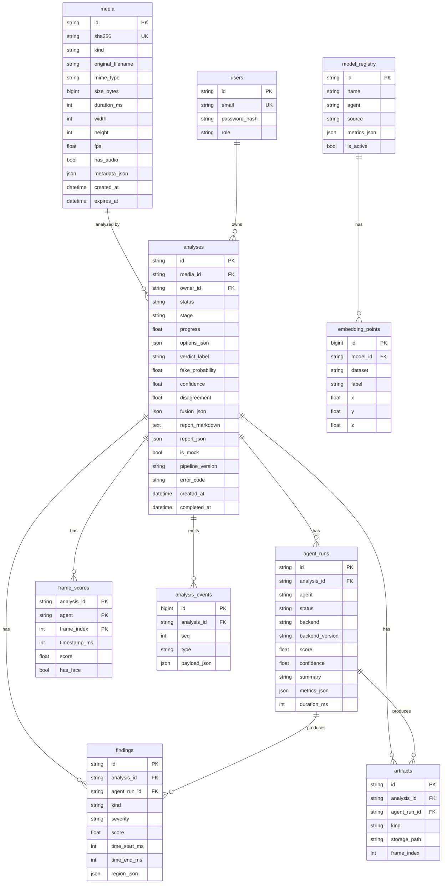

# Data Schema

Database: **SQLite** in development (`data/app.db`), **PostgreSQL 16** for deployment. ORM: SQLAlchemy 2.0 (async). Migrations: Alembic — every schema change is a migration; never edit the DB by hand. See [ADR-005](Decisions.md#adr-005).

## Conventions

- Primary keys are prefixed ULID strings (`VARCHAR(32)`), generated in Python.
- Timestamps are `TIMESTAMP WITH TIME ZONE`, stored in UTC.
- JSON columns use SQLAlchemy `JSON` (→ `JSONB` on Postgres, `TEXT` on SQLite). Their shapes are defined by Pydantic models in `app/schemas/` and validated on write.
- Enums are stored as `VARCHAR` with a `CHECK` constraint (portable across SQLite and Postgres).
- Deletes cascade from `media` → `analyses` → everything else. Files on disk are removed by the service layer in the same operation.

## ER diagram

## Tables

### `media`

| Column | Type | Null | Notes |
|---|---|---|---|
| `id` | varchar(32) PK | no | `med_…` |
| `sha256` | char(64) UNIQUE | no | Dedup key |
| `kind` | varchar(8) | no | `image \| video \| audio` |
| `original_filename` | varchar(255) | no | Sanitized; display only, never used in paths |
| `mime_type` | varchar(64) | no | From magic-byte sniffing, not the client header |
| `size_bytes` | bigint | no | |
| `duration_ms` | int | yes | video/audio |
| `width`, `height` | int | yes | image/video |
| `fps` | real | yes | video |
| `has_audio` | boolean | yes | video |
| `frame_count` | int | yes | video, from ffprobe |
| `storage_path` | varchar(512) | no | Relative to `DATA_DIR` |
| `thumbnail_path` | varchar(512) | yes | |
| `metadata_json` | json | no | ffprobe/EXIF subset (`{}` default) |
| `created_at` | timestamptz | no | |
| `expires_at` | timestamptz | yes | `created_at + RETENTION_DAYS`; null = keep (demo set) |

Indexes: `ix_media_created_at`, `ix_media_expires_at`.

### `analyses`

| Column | Type | Null | Notes |
|---|---|---|---|
| `id` | varchar(32) PK | no | `ana_…` |
| `media_id` | FK → media.id ON DELETE CASCADE | no | |
| `owner_id` | FK → users.id ON DELETE SET NULL | yes | Unused until auth (Phase 6 optional) |
| `status` | varchar(12) | no | `queued \| running \| completed \| failed \| cancelled` |
| `stage` | varchar(16) | no | `queued \| preprocessing \| agents \| fusion \| judge \| finalizing \| done` |
| `progress` | real | no | 0–1 |
| `options_json` | json | no | `AnalysisOptions` |
| `verdict_label` | varchar(10) | yes | `real \| fake \| uncertain` |
| `fake_probability` | real | yes | Fused p |
| `confidence` | real | yes | |
| `disagreement` | real | yes | |
| `fusion_json` | json | yes | Full `Verdict` incl. weights and contributions |
| `report_markdown` | text | yes | Judge output |
| `report_json` | json | yes | `{key_evidence, caveats, backend, model, usage}` |
| `is_mock` | boolean | no | True if any scoring agent was mock |
| `pipeline_version` | varchar(16) | no | App version at run time |
| `error_code`, `error_message` | varchar | yes | |
| `created_at`, `started_at`, `completed_at` | timestamptz | created: no | |
| `duration_ms` | int | yes | |

Indexes: `ix_analyses_created_at`, `ix_analyses_status`, `ix_analyses_verdict_label`, `ix_analyses_media_id`.

### `agent_runs`

| Column | Type | Null | Notes |
|---|---|---|---|
| `id` | varchar(32) PK | no | `run_…` |
| `analysis_id` | FK CASCADE | no | |
| `agent` | varchar(10) | no | `visual \| temporal \| audio \| judge` |
| `status` | varchar(10) | no | `pending \| running \| completed \| failed \| skipped \| cancelled` |
| `backend` | varchar(8) | yes | `mock \| model \| llm \| rules` |
| `backend_version` | varchar(64) | yes | e.g. `mock-1`, `gend-clip-l14@v1`, `claude-opus-5-5` |
| `score`, `confidence` | real | yes | |
| `summary` | varchar(500) | yes | |
| `metrics_json` | json | no | Agent-specific numbers; Judge stores token usage here |
| `error_code`, `error_message` | varchar | yes | |
| `started_at`, `completed_at` | timestamptz | yes | |
| `duration_ms` | int | yes | |

Unique: `(analysis_id, agent)`.

### `findings`

| Column | Type | Null | Notes |
|---|---|---|---|
| `id` | varchar(32) PK | no | `fnd_…` |
| `analysis_id` | FK CASCADE | no | Denormalized for fast queries |
| `agent_run_id` | FK CASCADE | no | |
| `kind` | varchar(32) | no | See [API.md Finding](API.md#finding) |
| `title` | varchar(160) | no | |
| `description` | text | no | |
| `severity` | varchar(8) | no | `info \| low \| medium \| high` |
| `score` | real | yes | |
| `time_start_ms`, `time_end_ms` | int | yes | |
| `frame_index` | int | yes | |
| `region_json` | json | yes | `{x,y,w,h}` normalized |
| `artifact_id` | FK → artifacts.id SET NULL | yes | |
| `created_at` | timestamptz | no | |

Index: `ix_findings_analysis_id`.

### `frame_scores`

| Column | Type | Null | Notes |
|---|---|---|---|
| `analysis_id` | FK CASCADE | no | PK part |
| `agent` | varchar(10) | no | PK part |
| `frame_index` | int | no | PK part |
| `timestamp_ms` | int | no | |
| `score` | real | no | |
| `has_face` | boolean | no | |
| `face_box_json` | json | yes | |

### `artifacts`

| Column | Type | Null | Notes |
|---|---|---|---|
| `id` | varchar(32) PK | no | `art_…` |
| `analysis_id` | FK CASCADE | no | |
| `agent_run_id` | FK CASCADE | yes | Null for preprocessing artifacts (keyframes, crops) |
| `kind` | varchar(16) | no | `keyframe \| face_crop \| heatmap \| spectrum \| flow_map \| waveform \| spectrogram \| report_pdf` |
| `mime_type` | varchar(32) | no | |
| `storage_path` | varchar(512) | no | |
| `width`, `height` | int | yes | |
| `frame_index` | int | yes | |
| `meta_json` | json | no | |
| `created_at` | timestamptz | no | |

Index: `(analysis_id, kind)`.

### `analysis_events`

| Column | Type | Null | Notes |
|---|---|---|---|
| `id` | bigint PK autoincrement | no | |
| `analysis_id` | FK CASCADE | no | |
| `seq` | int | no | Monotonic per analysis, starts at 1; SSE `id` |
| `type` | varchar(32) | no | See [API.md §6](API.md#6-server-sent-events) |
| `agent` | varchar(10) | yes | |
| `payload_json` | json | no | |
| `created_at` | timestamptz | no | |

Unique: `(analysis_id, seq)`. `judge.token` events are persisted too (so a refresh can replay the typing). Rows older than the analysis retention are removed with it.

### `model_registry`

| Column | Type | Null | Notes |
|---|---|---|---|
| `id` | varchar(48) PK | no | `mdl_…`, human-readable slug allowed |
| `name` | varchar(120) | no | |
| `agent` | varchar(10) | no | Which agent uses it |
| `family` | varchar(48) | yes | `clip-vit-l14`, `efficientnet-b4`, `xlsr-aasist`… |
| `source` | varchar(12) | no | `ours \| paper \| placeholder` |
| `train_dataset` | varchar(64) | yes | |
| `params_total_m`, `params_trainable_m` | real | yes | Millions |
| `metrics_json` | json | no | List of `{dataset, split, auc, accuracy, eer, ece}` |
| `roc_json` | json | yes | `{dataset: [[fpr, tpr], …]}` |
| `notes` | text | yes | Citation required when `source=paper` |
| `is_active` | boolean | no | Currently used by an agent |
| `created_at` | timestamptz | no | |

Seeded by `scripts/seed_models.py` (placeholders + paper baselines); Phase 7 adds `ours` rows from `ml/exports/*/model_card.json`.

### `embedding_points`

| Column | Type | Null | Notes |
|---|---|---|---|
| `id` | bigint PK | no | |
| `model_id` | FK → model_registry.id CASCADE | no | |
| `dataset` | varchar(48) | no | |
| `split` | varchar(12) | no | `train \| val \| test` |
| `label` | varchar(8) | no | `real \| fake` |
| `manipulation` | varchar(32) | yes | `Deepfakes`, `Face2Face`, `FaceSwap`, `NeuralTextures`, … |
| `x`, `y`, `z` | real | no | UMAP / t-SNE output |
| `thumb_path` | varchar(512) | yes | Small face crop for hover (only for datasets whose license allows it) |

Index: `(model_id, dataset)`. Before Phase 7, a synthetic demo set may be seeded **only** with `model_id = mdl_placeholder_demo`, and the UI labels it "synthetic demo data".

### `users` (optional, Phase 6)

| Column | Type | Null | Notes |
|---|---|---|---|
| `id` | varchar(32) PK | no | `usr_…` |
| `email` | varchar(254) UNIQUE | no | Lower-cased |
| `password_hash` | varchar(255) | no | argon2id |
| `role` | varchar(8) | no | `admin \| viewer` |
| `created_at` | timestamptz | no | |

## Retention job

On startup and every hour: delete `media` where `expires_at < now()` (cascades), then delete orphaned directories under `data/analyses/`. Demo media have `expires_at = NULL`.

## Migration policy

1. Change the ORM model → `alembic revision --autogenerate -m "short message"` → **review the generated file** → commit it.
2. Migrations must run on both SQLite and Postgres (use `batch_alter_table` for SQLite column changes).
3. Never edit a migration that has been merged; add a new one.
4. Update this document in the same PR.
