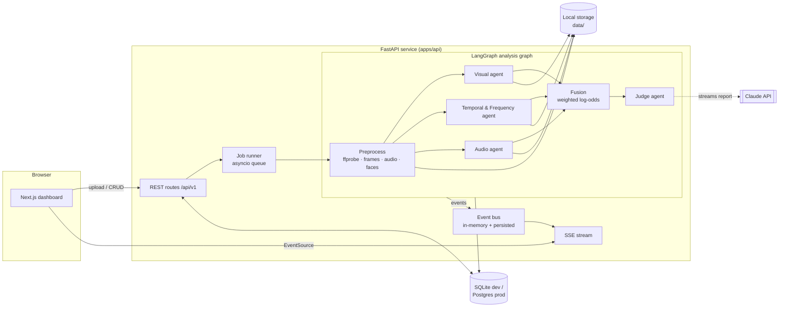
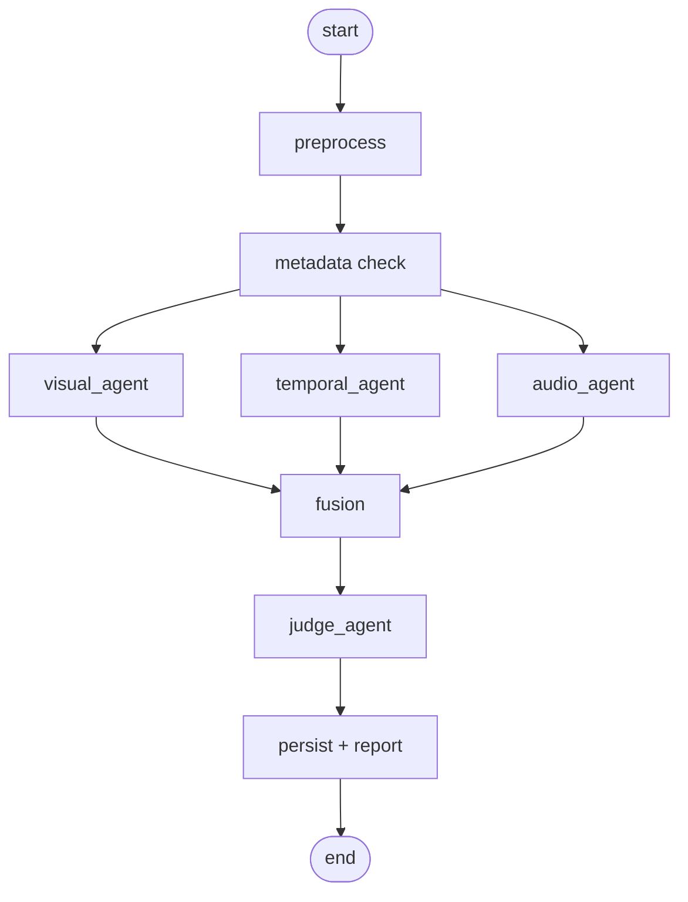

# Technical Specifications

Status: Draft v0.1 · Companion docs: [API.md](API.md), [Schema.md](Schema.md), [Decisions.md](Decisions.md)

## 1. Architecture overview



**Key idea:** every agent calls a **Detector** through an interface. In Phases 1–6 the detectors are *mock* (deterministic, clearly labeled) while all the surrounding signal processing is real: frame extraction, face detection, FFT spectra, optical flow, spectrograms. In Phases 7–8 we register real models (GenD, Effort, EfficientNet-B4, a temporal classifier, XLS-R + AASIST) and the app does not change. See [ADR-004](Decisions.md#adr-004).

## 2. Tech stack

### 2.1 Backend — `apps/api`

| Concern | Choice | Notes |
|---|---|---|
| Language | Python 3.12 | Same language as the ML stack |
| Package manager | `uv` | Fast, lockfile (`uv.lock`) |
| Web framework | FastAPI + Pydantic v2 | OpenAPI generated automatically → frontend types |
| Settings | `pydantic-settings` | `.env` driven, typed |
| DB | SQLAlchemy 2.0 (async) + Alembic | `aiosqlite` in dev, `asyncpg` for Postgres |
| Orchestration | LangGraph | Graph: preprocess → 3 parallel agents → fusion → judge |
| Streaming | `sse-starlette` | Server-Sent Events with `Last-Event-ID` replay |
| LLM | `anthropic` Python SDK (`AsyncAnthropic`) | Judge agent; model `claude-opus-5-5` (env-configurable) |
| Media | `ffmpeg`/`ffprobe` (system binaries), OpenCV, NumPy, Pillow, SciPy | `librosa` for audio features |
| File type sniffing | `filetype` | Magic-byte check, pure Python (works on Windows) |
| PDF | ReportLab | Pure Python, no GTK dependency on Windows |
| IDs | Prefixed ULIDs (`python-ulid`) | `med_…`, `ana_…`, `run_…`, `art_…`, `fnd_…` |
| Logging | `structlog` (JSON in prod, pretty in dev) | Request ID on every line |
| Rate limiting | `slowapi` | Per-IP limits on upload and analysis creation |
| Lint / type | Ruff (lint + format), Pyright (strict on `app/`) | |
| Tests | pytest, pytest-asyncio, httpx `AsyncClient` | |

### 2.2 Frontend — `apps/web`

| Concern | Choice | Notes |
|---|---|---|
| Framework | Next.js (App Router, latest stable) + React 19 + TypeScript `strict` | |
| Package manager | `pnpm` | |
| Styling | Tailwind CSS v4 + CSS variables (tokens in [Design.md](Design.md)) | |
| Components | shadcn/ui (Radix primitives), `lucide-react` icons | Components copied in, owned by us |
| Motion | `motion` (Framer Motion) | Respect `prefers-reduced-motion` |
| Charts | Recharts for standard charts; hand-built SVG for the gauge and timeline | |
| 3D | `@react-three/fiber` + `@react-three/drei` | Hero + embedding explorer, lazy-loaded |
| Audio | `wavesurfer.js` | Waveform + region highlights |
| Server state | TanStack Query | Caching, retries, invalidation |
| UI state | Zustand | War-room event store, UI prefs |
| API types | `openapi-typescript` generated from FastAPI's `/openapi.json` | `pnpm gen:api` — never hand-write API types |
| Validation | `zod` | Forms and SSE payload parsing |
| Uploads | `react-dropzone` + XHR for progress events | |
| Toasts / palette | `sonner`, `cmdk` | |
| Tests | Vitest + Testing Library; Playwright for E2E | |

### 2.3 ML (Phases 7–8 — see [phases/](phases/))

PyTorch, `timm`, `transformers`, `open_clip`, face detection with RetinaFace (or MediaPipe as a lighter fallback), training in `ml/` with configs under `ml/configs/`. Candidate models from the research note: GenD (CLIP ViT-L/14, LayerNorm tuning), Effort (SVD), EfficientNet-B4 and Xception baselines, XLS-R + AASIST for audio. Exported weights are loaded by detector classes in `apps/api/app/detectors/`.

## 3. Repository layout

```
UML501-MACHINE-LEARNING/
├── apps/
│   ├── api/                      # FastAPI service
│   │   ├── app/
│   │   │   ├── main.py           # app factory, middleware, routers
│   │   │   ├── config.py         # Settings (pydantic-settings)
│   │   │   ├── api/v1/           # routers: media, analyses, agents, models, metrics, health
│   │   │   ├── schemas/          # Pydantic request/response models (API contract)
│   │   │   ├── db/               # engine, session, ORM models, repositories
│   │   │   ├── services/         # media_service, analysis_service, report_service
│   │   │   ├── jobs/             # runner.py (queue + workers), recovery on startup
│   │   │   ├── events/           # bus.py (pub/sub + persistence), sse.py
│   │   │   ├── pipeline/         # graph.py (LangGraph), state.py, preprocess.py, fusion.py
│   │   │   ├── agents/           # base.py, visual.py, temporal.py, audio.py, judge.py
│   │   │   ├── detectors/        # base.py, registry.py, mock/, (Phase 7: gend.py, effort.py, ...)
│   │   │   ├── media/            # probe.py, frames.py, faces.py, audio.py, spectrum.py, flow.py
│   │   │   ├── storage/          # base.py, local.py
│   │   │   ├── llm/              # claude_client.py, prompts/, rule_based_judge.py
│   │   │   └── utils/            # ids.py, errors.py, timing.py
│   │   ├── alembic/
│   │   ├── tests/                # unit/, integration/, fixtures/
│   │   ├── pyproject.toml
│   │   └── Dockerfile
│   └── web/                      # Next.js dashboard
│       ├── src/
│       │   ├── app/              # routes (see Appflow.md)
│       │   ├── components/
│       │   │   ├── ui/           # shadcn primitives
│       │   │   ├── forensics/    # VerdictGauge, AgentCard, EvidenceTimeline, HeatmapViewer, ...
│       │   │   ├── charts/
│       │   │   └── layout/
│       │   ├── lib/
│       │   │   ├── api/          # client.ts, generated/schema.d.ts, queries.ts
│       │   │   ├── sse/          # useAnalysisStream.ts
│       │   │   └── utils/
│       │   ├── stores/           # warRoomStore.ts, prefsStore.ts
│       │   └── styles/           # globals.css (tokens)
│       ├── tests/ · e2e/
│       ├── package.json
│       └── Dockerfile
├── ml/                           # Phase 7: training, evaluation, export
├── data/                         # gitignored: uploads, artifacts, sqlite, demo set
├── docs/                         # you are here
├── docker-compose.yml
├── .github/workflows/ci.yml
└── README.md
```

## 4. Backend design

### 4.1 Layers

`routers` (HTTP only; validate, call a service, map errors) → `services` (business rules) → `repositories` (DB access) and `pipeline` (analysis). Routers never touch the ORM directly. Services never import FastAPI.

### 4.2 Job runner

- `POST /analyses` writes an `analyses` row with `status=queued` and puts its ID on an `asyncio.Queue`.
- `JOB_CONCURRENCY` workers (default **1** on CPU, 2 on GPU) pull IDs and run the LangGraph pipeline.
- Cancellation: a per-job `asyncio.Event`, checked between graph nodes and between frame batches.
- On startup, rows left in `running` are marked `failed` with `error_code=INTERRUPTED`; `queued` rows are re-enqueued.
- Swap path: the runner is behind a `JobQueue` protocol so it can move to Redis + `arq` if we need several processes ([ADR-006](Decisions.md#adr-006)).

### 4.3 Event bus and SSE

- Every pipeline step emits a typed event (catalogue in [API.md §6](API.md#6-server-sent-events)).
- Events are **persisted** to `analysis_events` with a per-analysis monotonic `seq`, then fanned out to in-memory subscribers.
- `GET /analyses/{id}/events` first replays persisted events after `Last-Event-ID`, then streams live events. A page refresh mid-analysis therefore loses nothing.
- Heartbeat comment every 15 s; the stream closes after `analysis.completed` / `analysis.failed` / `analysis.cancelled`.

### 4.4 Analysis pipeline (LangGraph)



Routing by media kind:

| Media kind | Visual | Temporal & Frequency | Audio | Judge |
|---|---|---|---|---|
| image | ✅ | frequency only (no temporal) | skipped | ✅ |
| video with audio | ✅ | ✅ | ✅ | ✅ |
| video without audio | ✅ | ✅ | skipped | ✅ |
| audio | skipped | skipped | ✅ | ✅ |

A skipped agent emits `agent.skipped` with a reason and is excluded from fusion. A **failed** agent does not fail the analysis if at least one scoring agent succeeded; the Judge is told which agent failed. The analysis fails only if preprocessing fails or all scoring agents fail.

**Graph state** (`pipeline/state.py`), simplified:

```python
class AnalysisState(TypedDict):
    analysis_id: str
    media: MediaInfo                 # kind, duration, fps, has_audio, paths
    options: AnalysisOptions
    frames: list[FrameRef]           # sampled frames + face boxes
    audio_path: str | None
    metadata_findings: list[Finding]
    agent_results: Annotated[dict[AgentName, AgentResult], merge_dicts]
    fusion: FusionResult | None
    verdict: Verdict | None
```

### 4.5 Preprocessing

1. `ffprobe` → duration, fps, resolution, codecs, audio presence (subprocess, argument list, 20 s timeout).
2. **Frame sampling:** `num_frames` evenly spaced (default **32**, max 64). Decode with OpenCV; downscale so the long side ≤ 1280 px.
3. **Face detection:** OpenCV `FaceDetectorYN` (YuNet; a small ONNX file fetched by `scripts/fetch_assets.py`), falling back to the Haar cascade bundled with `opencv-python` if the file is missing → largest face per frame, bbox expanded by 30%, aligned 224×224 crop saved. Frames without a face are marked `face=false`. Phase 7 may swap in RetinaFace to match the training pipeline.
4. **Audio:** `ffmpeg` → 16 kHz mono WAV (first 5 min max).
5. **Metadata check (F-18):** EXIF / container tags, encoder strings, C2PA manifest presence. Produces findings, not a score.
6. Thumbnails: poster frame (video) or resized image, 480 px wide WebP.

### 4.6 Agents

All agents implement one interface:

```python
class Agent(Protocol):
    name: AgentName                       # "visual" | "temporal" | "audio" | "judge"
    async def run(self, state: AnalysisState, ctx: AgentContext) -> AgentResult: ...
```

`AgentContext` provides `emit(event)`, `storage`, `cancel_event`, `settings`, and a logger. An agent emits `agent.started`, several `agent.progress` / `agent.log`, one or more `agent.finding`, then `agent.completed` (or `agent.failed`).

**AgentResult** (also the API shape; see [API.md](API.md#agentresult)):

```python
class AgentResult(BaseModel):
    agent: AgentName
    status: Literal["completed", "failed", "skipped"]
    backend: Literal["mock", "model", "llm", "rules"]
    backend_version: str                 # e.g. "mock-1", "gend-clip-l14@ff++c23-v1"
    score: float | None                  # P(fake) in [0,1]; None for judge/skipped
    confidence: float | None             # [0,1], how much the agent trusts its own score
    summary: str                         # one line for the agent card
    findings: list[Finding]
    frame_scores: list[FrameScore]       # video only
    artifacts: list[ArtifactRef]
    metrics: dict[str, float]            # agent-specific numbers (e.g. hf_energy_ratio)
    duration_ms: int
```

| Agent | Inputs | Real computation (from Phase 2) | Detector (mock → Phases 7–8) | Outputs |
|---|---|---|---|---|
| **Visual Forensics** | face crops, full frames | face detection, per-frame crop quality, blur (Laplacian variance) | `mock-visual` → GenD / Effort / ensemble | per-frame P(fake), video score, heatmaps (Grad-CAM in Phase 7; mock saliency before that), top suspicious frames |
| **Temporal & Frequency** | frame sequence, crops | 2D FFT azimuthal power spectrum + high-frequency energy ratio; frame-to-frame SSIM; Farneback optical-flow magnitude variance in the face region; face bbox jitter | `mock-temporal` → classical-feature classifier (logistic regression / XGBoost on these features) and optionally a video model | temporal inconsistency curve, spectrum images, flicker segments |
| **Audio** | 16 kHz WAV | log-mel spectrogram, RMS energy, silence ratio, pitch track | `mock-audio` → XLS-R + AASIST | P(fake), suspicious segments, spectrogram image |
| **Judge** | all AgentResults, fusion result, metadata findings, 3–4 keyframes + heatmaps | deterministic fusion (§4.7) | Claude API (`backend=llm`) → fallback template (`backend=rules`) | verdict label, explanation, key evidence list, disagreement notes |

**Mock detectors** (`detectors/mock/`) are deterministic: the seed is `sha256(media) + agent name`, so the same file always gives the same result. They produce plausible *shapes* (smooth per-frame curves, a few peaks) so the UI can be built properly. In `APP_ENV=development` only, `options.mock_scenario` (`real`, `fake`, `uncertain`, `disagree`, `agent_fail`) forces a scenario for UI testing. Every mock result carries `backend="mock"`, and the UI must show it ([Rules.md](Rules.md#r-honesty)).

### 4.7 Fusion (the math)

Each scoring agent *i* returns a fake probability *pᵢ* and a confidence *cᵢ*. Combine in log-odds space:

$$
\ell_i = \log\frac{p_i}{1-p_i}, \qquad
z = \frac{\sum_i w_i c_i \ell_i}{\sum_i w_i c_i}, \qquad
p = \sigma(z) = \frac{1}{1+e^{-z}}
$$

- Default weights *w*: visual 0.5, temporal 0.3, audio 0.2, renormalized over agents that actually ran. *pᵢ* is clipped to [0.001, 0.999].
- **Disagreement** *d* = max |pᵢ − pⱼ| over pairs of scoring agents.
- **Label:** `fake` if *p* ≥ 0.65, `real` if *p* ≤ 0.35, otherwise `uncertain`. Also `uncertain` if *d* > 0.5 and the overall confidence *c̄* = Σwᵢcᵢ / Σwᵢ < 0.6.
- **Overall confidence** = *c̄* · (1 − 0.5·*d*).
- Phase 8 replaces the hand-set weights with a logistic-regression stacker trained on a validation split, and calibrates with temperature scaling (fit *T* to minimize validation NLL, report ECE before/after).

**The Judge never changes the number.** Fusion is deterministic and reproducible; the LLM explains it, highlights evidence, and may add a `caveats` list ([ADR-007](Decisions.md#adr-007)).

### 4.8 Judge agent (Claude)

- SDK: `anthropic` (`AsyncAnthropic`). Model from `JUDGE_MODEL`, default `claude-opus-5-5`. Effort from `JUDGE_EFFORT` (set explicitly; default `medium`). Adaptive thinking is on by default for this model, so we don't set a thinking config.
- **Streaming:** `client.messages.stream(...)`; each text delta becomes a `judge.token` SSE event, so the report types itself out in the war room.
- **Output:** a Markdown report, then a fenced JSON block of `{ key_evidence: [...], caveats: [...] }` that we validate with Pydantic. If validation fails, the report text is kept and the lists are empty.
- **Input:** a system prompt (static, cacheable) + one user message containing agent results as JSON inside `<agent_results>` tags, fusion numbers, metadata findings inside `<untrusted_metadata>` tags, and 3–4 downscaled keyframes / heatmaps as images. The prompt states that everything inside those tags is data, not instructions ([Security.md §5](Security.md#5-llm--prompt-injection)).
- **Refusals and fallbacks:** check `stop_reason` before reading content; enable server-side fallback (`fallbacks: "default"` with beta `server-side-fallback-2026-07-01`). On any API error, timeout (`JUDGE_TIMEOUT_S`, default 60 s), missing key, or `JUDGE_ENABLED=false` → use `rule_based_judge.py`, which fills a template from the fusion numbers and top findings (`backend="rules"`).
- **Cost control:** one Judge call per analysis; images downscaled to ≤ 768 px; `max_tokens` 4 000; prompt caching on the system prompt; usage logged per analysis in `agent_runs.metrics_json`.
- Optional later: specialist agents may ask Claude for a short "semantic observation" on keyframes (lighting, reflections, hair/ear boundaries), behind `AGENT_LLM_OBSERVATIONS=false` by default.

### 4.9 Storage layout

```
data/
├── app.db                               # SQLite (dev)
├── media/{media_id}/original.{ext}
├── media/{media_id}/thumb.webp
├── media/{media_id}/audio16k.wav
├── analyses/{analysis_id}/frames/{idx:03d}.jpg
├── analyses/{analysis_id}/faces/{idx:03d}.jpg
├── analyses/{analysis_id}/artifacts/{artifact_id}.{png|webp|json}
├── analyses/{analysis_id}/report.pdf
└── demo/                                # curated demo clips + manifest.json
```

Paths are always built from generated IDs, never from user filenames. Storage sits behind a `Storage` protocol (`put`, `open`, `url_for`, `delete_prefix`) so S3 / R2 can be added later.

### 4.10 Configuration (`apps/api/.env`)

The full table is in [Setup.md](Setup.md#4-environment-variables). Important ones: `APP_ENV`, `DATABASE_URL`, `DATA_DIR`, `CORS_ORIGINS`, `MAX_UPLOAD_MB_{IMAGE,VIDEO,AUDIO}`, `MAX_VIDEO_SECONDS`, `NUM_FRAMES`, `JOB_CONCURRENCY`, `DETECTOR_{VISUAL,TEMPORAL,AUDIO}`, `ANTHROPIC_API_KEY`, `JUDGE_ENABLED`, `JUDGE_MODEL`, `JUDGE_EFFORT`, `RETENTION_DAYS`, `API_ACCESS_TOKEN`.

### 4.11 Observability

- Structured logs with `request_id` and `analysis_id`.
- Per-stage timing written to `agent_runs.duration_ms` and exposed on `GET /metrics/overview`.
- `GET /health` (liveness) and `GET /health/ready` (DB reachable, ffmpeg present, storage writable, detector registry loaded, Judge configured).

## 5. Frontend design

### 5.1 Data flow

- **REST** via a thin typed client (`lib/api/client.ts`) built on `fetch` + generated OpenAPI types. TanStack Query hooks in `lib/api/queries.ts`.
- **SSE** via `useAnalysisStream(analysisId)`: opens an `EventSource`, parses each event with zod, dispatches into `warRoomStore` (Zustand). It reconnects automatically (the browser sends `Last-Event-ID`). On a terminal event it closes and invalidates the `analysis` query so the final persisted result replaces the streamed state.
- **Uploads** use XHR for progress events, then `POST /analyses`, then navigate to `/analyses/{id}`.

### 5.2 Rendering

- Server Components for static shells (about page, layout); Client Components for anything interactive or streaming.
- Heavy modules (`three`, `wavesurfer.js`, Recharts) are dynamically imported per route.
- Images and artifacts come from the API (`/api/v1/artifacts/{id}`) with long cache headers; they are immutable by ID.

### 5.3 Performance budgets

| Metric | Budget |
|---|---|
| JS on `/dashboard` first load | ≤ 200 KB gzipped (3D excluded) |
| LCP (desktop, local API) | ≤ 1.5 s |
| War-room update | Event to paint ≤ 100 ms; `judge.token` rendering batched per animation frame |
| Timeline | 60 fps scrub with 64 frames |

### 5.4 Browser support

Latest Chrome, Edge, Firefox, Safari. Mobile Safari/Chrome for viewing results (upload works; the war room is responsive).

## 6. Performance targets (backend, CPU, mock detectors)

| Input | Target end-to-end |
|---|---|
| 1080p image | ≤ 5 s (≤ 12 s with Judge) |
| 30 s 1080p video, 32 frames, with audio | ≤ 30 s (≤ 45 s with Judge) |
| 60 s audio | ≤ 10 s (≤ 25 s with Judge) |

Phase 7 targets are set once models are chosen; GPU inference for GenD on 32 face crops should take under 2 s.

## 7. ML hook points, Phases 7–8 (so ML slots in cleanly)

| Hook | File | Contract |
|---|---|---|
| Detector class | `detectors/base.py` | `async predict(inputs) -> DetectorOutput(score, confidence, frame_scores, saliency_maps)` |
| Registry | `detectors/registry.py` | `DETECTOR_VISUAL=gend-clip-l14` picks the class; `backend_version` is recorded on every run |
| Model metadata | `model_registry` table | Seeded from `ml/exports/*/model_card.json` |
| Embeddings | `embedding_points` table | Exported by `ml/scripts/export_embeddings.py` |
| Fusion weights | `pipeline/fusion.py` | Load `fusion.json` (stacker weights + temperature) if present, else defaults |
